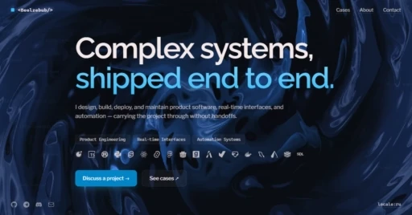

[](https://www.npmjs.com/~gmod.one) [](https://discord.gmod.one) [](https://www.gmodstore.com/users/beelzebub) [](https://t.me/be1zebub)

 [](mailto:hello@bzbb.dev)  

<picture>
  <source media="(prefers-color-scheme: dark)" srcset="https://github.com/Be1zebub/git-pf-stats-svg/raw/master/output/dark.svg">
  
</picture>

```yaml
user:
  name: Beelzebub
  contact: hello@bzbb.dev
  timezone: UTC +07:00
  portfolio: bzbb.dev
  age: 26
  active: true
  skills:
    - Software engineering
    - UX/UI design
    - Game design  
  languages:
    - TypeScript
    - JavaScript
    - Lua
    - Rust
    - Python
    - Php
    - GDscript
  frameworks:
    - Svelte
    - React
    - Vue
    - Tauri
    - Electron
    - GPUI
  databases:
    - MariaDB
    - Redis
    - Postgres
    - SQLite
    - Prisma ORM
  games:
    - FiveM
    - GMod
```

  
https://bzbb.dev/

pf stats svg are generated with [github.com/Be1zebub/git-pf-stats-svg](https://github.com/Be1zebub/git-pf-stats-svg)  

